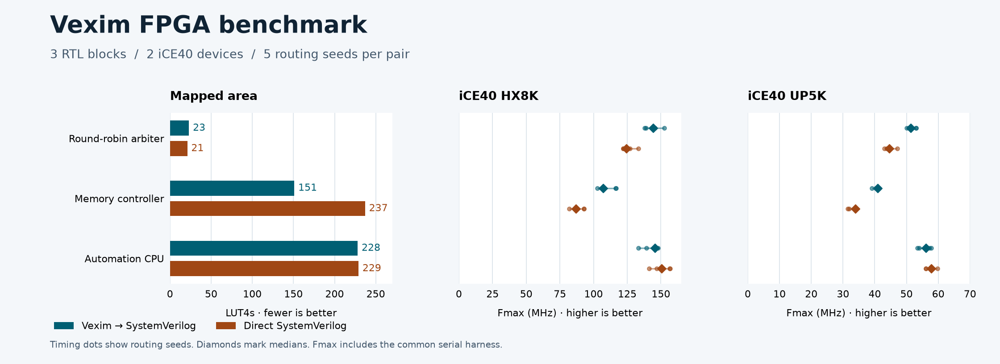

# Vexim

An explicitly typed hardware language with a Rust compiler that emits synthesizable SystemVerilog.

## Measured results



Frozen designs from one paired Gemini 4 Argon experiment, mapped with Yosys 0.33
to iCE40 primitives. All six designs pass Verilator lint, independent simulation, and Yosys synthesis.

| Block | Generic cells Vexim / SV | iCE40 LUT4 Vexim / SV | FF Vexim / SV | iCE40 synthesis seconds Vexim / SV |
|---|---:|---:|---:|---:|
| Round-robin arbiter | 56 / 80 | 23 / 21 | 7 / 7 | 1.07 / 0.92 |
| Memory controller | 396 / 557 | 151 / 237 | 68 / 68 | 1.22 / 1.32 |
| Automation CPU | 530 / 660 | 228 / 229 | 163 / 163 | 1.42 / 1.62 |

The controller used **36.3% fewer LUT4s**, and its median Fmax was higher
on both devices. The arbiter used two more LUT4s and also ran faster on both.
The automation CPU used nearly the same number of LUT4s and ran slightly
slower on both. Fmax comes from a common serial test harness. In the original
generation experiment, Vexim took more tokens and time.
See [methods and per-device timing](benchmarks/README.md).

Reproduce synthesis, simulation, and timing from this checkout with Docker:

```sh
sh run_benchmarks.sh
```

The first run downloads and builds the tool image. Cached runs complete in
seconds on the development machine. Synthesis times depend on the host.

A separate [SERV RISC-V memory-interface port](benchmarks/serv/README.md)
matched upstream LUT4 count and median routed Fmax, with formal equivalence
for the fixed one-bit profile.

The [complete educational RV32 CPU benchmark](benchmarks/rv32/README.md)
compares two Vexim register-bank designs against the same SystemVerilog
reference over 20,000 simulated cycles and five routing seeds.

## Write and compile hardware

Install from source:

```sh
cargo install --git https://github.com/yanmayck/vexim veximc
```

An explicit-width adder in Vexim and its equivalent SystemVerilog expression:

| Vexim operations | SystemVerilog |
|---|---|
| `comb left zext a` | `wire [8:0] left = {1'b0, a};` |
| `comb right zext b` | `wire [8:0] right = {1'b0, b};` |
| `comb sum add left right` | `assign sum = left + right;` |

The [language specification](SPEC.md) describes the syntax, width rules, and register behavior with complete examples.

```sh
cargo run -- check examples/adder.vxm
cargo run -- build examples/adder.vxm -o adder.sv
```

Requires Rust 1.85 or newer. The compiler has no third-party Rust dependencies.

```text
module adder
input a u8
input b u8
output sum u9
wire left u9
wire right u9
comb left zext a
comb right zext b
comb sum add left right
end
```

Version 0.3 accepts one module per file, with `#` comments and one statement per line. Names may contain ASCII letters, digits, and underscores, and may not start with a digit.

- `input NAME uN`, `output NAME uN`, and `wire NAME uN` declare unsigned signals of 1 to 64 bits.
- `comb DEST copy SRC` copies an equal-width signal. `zext` explicitly extends a narrower signal with zeros.
- `comb DEST OP A B` supports `add`, `sub`, `and`, `or`, and `xor` on equal-width signals. Arithmetic wraps at the declared width.
- `comb DEST const VALUE` assigns a decimal unsigned literal that fits the destination.
- `comb DEST slice SRC MSB LSB` extracts an inclusive range with the most significant index first. `comb DEST concat A B` joins two signals with `A` at the high end. The result must match the destination width.
- `comb DEST eq A B` and `comb DEST ne A B` compare equal-width signals and produce a `u1` result.
- `comb DEST mux SELECT A B` selects `A` when the one-bit selector is 1, and `B` when it is 0. Both branches must match the destination width.
- `sync DEST CLOCK RESET DATA [RESET_VALUE]` samples equal-width data on a rising clock edge. The active-high synchronous reset assigns an optional decimal value that fits the destination and defaults to zero. Clock and reset are one-bit inputs.
- Every output and wire requires exactly one driver. The compiler rejects combinational cycles and reports errors by source line.

`examples/uart_tx.vxm` implements an 8N1 UART transmitter at four clock cycles per bit. The public HDL suite simulates all 256 byte values, restart attempts while busy, successive frames, and a reset during transmission.

```sh
mkdir -p build
cargo run --locked -- build examples/uart_tx.vxm -o build/uart_tx.sv
```

With a local RTL Forge checkout, run `sh tests/check_rtl_forge_uart.sh ../rtl-forge` using Icarus Verilog, Yosys, SymbiYosys, and Z3. This runs the original testbench and compares `tx` and `busy` against the original module for 84 cycles after the initial reset. The reference is read from the local checkout.

The public compiler covers native Vexim input and SystemVerilog output. Legacy HDL import, cloud verification, and AI agents are planned for Vexim Cloud.

The [RAM example](examples/ram.vxm) uses an indexed memory with an independent read address, an enabled synchronous write, and parameters resolved at compile time. Build the default 16-word RAM or specialize it to 12 words with `--param DEPTH=12`.

## Memory controller roadmap

1. Validate indexed memories and parameter specialization in a small RAM using Icarus and Yosys.
2. Use the [40-bit memory controller](examples/mem_controller.vxm) as a reference. The external-memory interface carries 64-bit beats and splits commands across 4 KiB boundaries.
3. Give models the controller contract and verify their RTL with the same independent testbench. Measure acceptance, correction attempts, and generation time. Run a separate 1 GiB streaming test to measure sustained data integrity.

The language and compiler are released under the [Apache License 2.0](LICENSE).
