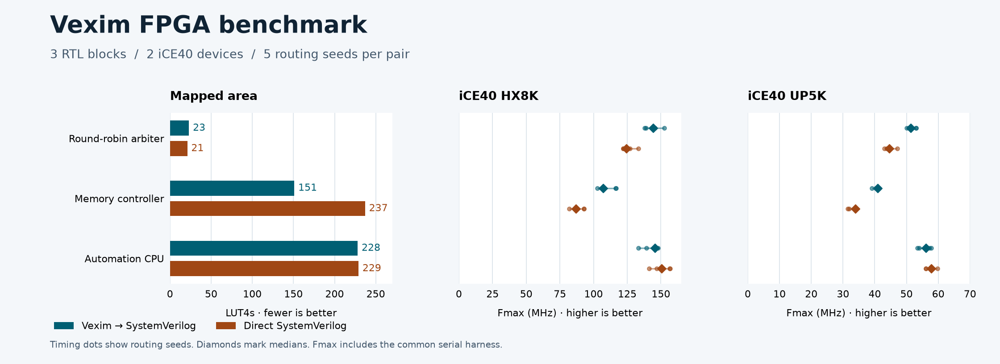

# Frozen paired synthesis benchmark

These sources are the six approved outputs from the 2026-11-18 Gemini 4 Argon
comparison, captured before the Vexim 0.3.1 dead-code elimination pass.
The Vexim-generated SystemVerilog is preserved so the published comparison
can be repeated independently of subsequent compiler changes. The original
`.vxm` sources are included for inspection.

Run `sh run_benchmarks.sh` from the repository root, or
`.\run_benchmarks.ps1` in PowerShell. Docker builds pinned Ubuntu packages
Yosys 0.33, Icarus 12, Verilator 5.020, and nextpnr-ice40 0.6. The runner lints and simulates
every design, synthesizes generic cells,
and maps every design using the same `synth_ice40` command. No API key,
model calls or GPU are needed. Results, logs, hashes and netlists are written
to `build/benchmarks`.

| Block | Vexim LUT4 | SystemVerilog LUT4 | Vexim FF | SystemVerilog FF |
|---|---:|---:|---:|---:|
| Round-robin arbiter | 23 | 21 | 7 | 7 |
| Memory controller | 151 | 237 | 68 | 68 |
| Automation CPU | 228 | 229 | 163 | 163 |

The paired behavioral specifications were identical and the reference
implementations and testbenches were excluded from model prompts. Each
language received up to two submissions and a fresh conversation. Vexim
additionally received its grammar. The fixed benches exercise arbitration,
memory descriptors and partial writes, and a software-interpreted CPU.

Both memory candidates also passed a separate 1 GiB write/readback harness.
Its `stream.cpp` is included. Running it requires Verilator and a C++
compiler and is outside the default lightweight benchmark image.

LUT4, flip-flop, carry and memory cell types remain in the JSON results.
## Post-route timing

All three blocks run through nextpnr on the iCE40 HX8K/CT256 and UP5K/SG48
with seeds 1 through 5 and a 50 MHz target. The standalone memory
controller exposes 386 I/O bits, beyond either package's capacity. All
pairs use the same five-pin serial harness structure, generated from
their sorted port lists. nextpnr automatically assigns the five pins.
Fmax estimates the single clock domain of the wrapped design after
routing. Board I/O timing and power are outside this benchmark.

| Block | HX8K Fmax, Vexim / SV (MHz) | UP5K Fmax, Vexim / SV (MHz) | UP5K meeting 50 MHz, Vexim / SV |
|---|---:|---:|---:|
| Round-robin arbiter | 144.22 / 124.36 | 51.30 / 44.58 | 5/5 / 0/5 |
| Memory controller | 107.17 / 86.95 | 40.89 / 33.93 | 0/5 / 0/5 |
| Automation CPU | 145.54 / 150.44 | 56.07 / 57.86 | 5/5 / 5/5 |

Fmax values are medians across the five seeds. All HX8K runs met 50 MHz.
All 60 configurations routed, including those missing their timing target.
Per-seed timing, packed logic cell counts and critical paths are in
`build/benchmarks/results.json` and the individual nextpnr reports.



Regenerate the figure from local results with Python and Matplotlib:

```sh
python -m pip install matplotlib
python benchmarks/plot.py build/benchmarks/results.json benchmarks/fpga-comparison.png
```
